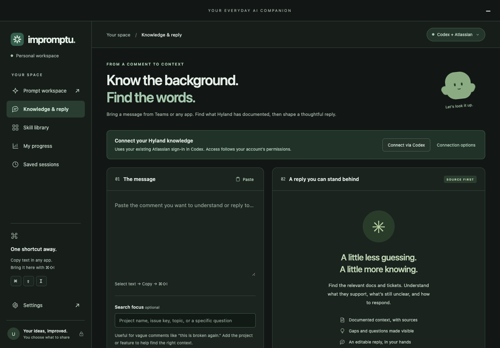

# Impromptu desktop

A Mac-first companion based on the [hackathon brief](https://impromptu-hackathon-brief.hyland-0170.chatgpt.site/#idea). Copy a message from Teams, summon Impromptu, look up Hyland documentation, and review a source-backed reply. The original prompt-coaching workspace remains available.

## Team development

Use **Node 24 LTS** on both Mac and Windows. `package.json` is the version source; `package-lock.json` is committed for reproducible installs.

```sh
npm ci
npm run doctor
npm run dev
```

`npm run dev` uses a separate `.cache/dev-user-data` profile so the installed app cannot intercept the development launch or share its settings. Quit the installed app while testing the global shortcut, because only one app can register it. Run `npm run verify` before opening a pull request. See [CONTRIBUTING.md](CONTRIBUTING.md) for the complete build and release flow.

The current source includes System, Light, Dark, Glass and Max-ind on both platforms, plus OpenRouter, Hugging Face and Bedrock SSO. Windows Glass uses CSS materials; native macOS vibrancy is Mac-only. Each developer configures their own AI access in Settings.

**Release status:** the historical publicised preview is v0.2.1. The newer source and local builds are not a published release until the **Desktop release** workflow finishes. That workflow builds Mac and Windows from one commit, tests each on its native runner, checks matching versions/checksums, and publishes both installers together. Its `publish` option defaults to off.

## Download an installer

- **[Download for Mac — Installer.pkg](https://github.com/rajpoot-rahul/InPromptU/releases/download/v0.2.1/Impromptu-0.2.1-Mac-Apple-Silicon-Installer.pkg)** — Apple Silicon, macOS 13 or later. Run the installer, then open **Applications → Impromptu**.
- **[Download for Windows — Setup.exe](https://github.com/rajpoot-rahul/InPromptU/releases/download/v0.2.1/Impromptu-0.2.1-Windows-x64-Setup.exe)** — Windows x64. Run Setup, then open **Impromptu** from the Start Menu or desktop shortcut. It includes an uninstaller in Windows Installed apps.

Both are unsigned hackathon preview builds. Sign in to a GitHub account with repository access to download from this private repository. [Portable ZIPs, checksums, and all release assets](https://github.com/rajpoot-rahul/InPromptU/releases/tag/v0.2.1) are also available.

## Project and downloads

- [Concept and product vision](docs/concept.md) — the original idea, the implemented prototype, and the proposed next steps.
- [Demo walkthrough](docs/demo.md) — a short prompt-coaching and knowledge-retrieval demo.
- [v0.2.1 release](https://github.com/rajpoot-rahul/InPromptU/releases/tag/v0.2.1) — separate Mac and Windows installers, optional portable apps, and SHA-256 checksums.
- [Release notes and limitations](docs/releases/v0.2.1.md).

Application downloads are attached to the GitHub release. A source checkout does not include the `release/` directory. This repository and its releases require repository access while private.



## Install and open the app

- **Apple Silicon Mac:** open `release/Impromptu-0.2.1-Mac-Apple-Silicon-Installer.pkg` and follow macOS Installer. This places **Impromptu.app** in **Applications**. Open it there, or use Spotlight (Command+Space → Impromptu). The installer requires macOS 13 or later on Apple Silicon. It does not download dependencies or run installation scripts.
- Impromptu runs in its **own desktop window**, loading the interface from files bundled inside the app. It is not a ChatGPT web page, extension, or embedded chat. Electron and the app code are included, so opening the installed app needs neither Node.js nor this project folder. **Hyland knowledge still requires the separate local Codex connection described below.** Installing Impromptu does not install Codex or grant Atlassian access.
- **Portable Mac alternative:** open `release/v<version>/Impromptu-darwin-arm64/Impromptu.app`. `Launch Impromptu.command` opens an installed copy, or starts the source when none is installed. Developers should use `npm run dev`.
- **Windows x64:** download and run `Impromptu-0.2.1-Windows-x64-Setup.exe`, choose the installation location, then launch Impromptu from its desktop or Start Menu shortcut. Setup defaults to the current user and also supports an all-users installation with administrator approval. Uninstall through Windows Installed apps. Saved sessions are retained by default.
- **Portable Windows alternative:** extract the entire `Impromptu-0.2.1-Windows-x64.zip`, then open `Impromptu.exe`. Keep its supporting files together.
- **Updating from an older version:** save your current draft and choose Quit Impromptu before opening the new version. Both versions use the same local saved-session folder. The old build has been left intact.
- The app must be running for its global shortcut to work. Closing the window keeps it in the menu bar/system tray. Choose **Quit Impromptu** there to stop it. It does not start automatically at login.

## Appearance

Open **Settings → Appearance** and choose **System**, **Light**, or **Dark**. Changes apply immediately and are remembered on this device. System follows the operating system, including changes while the app is running. The theme covers both workspaces, source excerpts, dialogs, inputs, and native window controls. It is selected before the window opens to avoid a bright startup flash.

## Keyboard workflow

1. Open **Knowledge & reply** and click **Connect via Codex**. Use a locally installed, signed-in Codex with its Atlassian connector enabled for `hyland.atlassian.net`.
2. Select and **copy** a comment in Teams or another app.
3. Press **Command+Shift+I** on Mac or **Ctrl+Shift+I** on Windows.
4. Review the message. Optionally add a project, topic or issue key under **Search focus**.
5. Click **Find context & draft reply**, or Command/Ctrl+Enter. Turn **Draft a reply with Codex** off to retrieve sources without AI synthesis.
6. Review the source passages, supported facts, uncertainties and editable reply. **Copy reply with sources**, then paste it into Teams yourself.

The shortcut brings copied text into the last-used workspace (Knowledge & reply or Prompt workspace). It does not read the currently selected text directly or watch Teams. Another open draft is preserved behind an incoming-text banner. Blank or oversized messages are rejected rather than submitted automatically.

## Prompt-coaching workflow

1. Select and copy a draft in ChatGPT, Claude, Codex, or another tool.
2. Choose **Prompt workspace**, then use the global shortcut or Paste.
3. Review the imported prompt. Choose a starter skill and optionally add context, audience and output format.
4. Click **Improve prompt** or press **Command/Ctrl+Enter** inside the app.
5. Review/edit the result, copy it, then paste into the original tool. Impromptu never sends that final prompt for you.

The shortcut reads clipboard text once. There is no background clipboard polling or typing observation. If another draft is open, the incoming text is offered in a banner instead of overwriting it. Disable clipboard import in Settings to make the shortcut only summon the app. If the shortcut is occupied, Settings reports that; open the app from its tray/menu-bar icon.

## What works

- Existing Codex Atlassian connection reused through the official local app-server, with each employee's permissions.
- Separate semantic searches of Confluence and Jira, direct reads of mentioned issue keys and Confluence links, and up to six retrieved sources per lookup.
- AI knowledge summary, source passages, explicit gaps, editable Teams reply and copyable source links. Search-only and partial-failure states are supported.
- Native Electron window, menu bar/system tray, global shortcut and explicit clipboard import/export.
- Side-by-side original and editable improvement, change explanation and clarification suggestions.
- Five versioned starter skills: clear thinking, customer response, code investigation, document summary, business analysis. These are example templates, **not approved Hyland policies**.
- Optional saved sessions, reopen/copy, helpfulness feedback, deletion and JSON export.
- Personal progress derived only from saved original briefs. The text checks are heuristic signals, not an aptitude/productivity score.
- Offline skill application, local Ollama with guided setup and health status, enforced local-only mode, and a configurable Chat Completions compatible API.
- **Tokenmining tools** in the Prompt workspace, chosen with **Improve / Compress / Explain**:
  - **Compress** rewrites the prompt to ask for the same thing in fewer tokens. It shows the before-and-after length and flags identifiers, numbers, quoted text and negations ("do not", "never", "only") that went missing.
  - **Explain** teaches: what the prompt asks, what works, what's unclear, and tokenmining tips. **Improve using these tips** carries them into an improvement.
  - Both need an AI model; offline mode refuses rather than faking a result.
  - Token figures are labelled **estimates** (characters ÷ 4). Ollama can't reliably report exact counts for arbitrary text, so exact counts appear only where the provider reports them for a request.
  - A **Tokenmining** starter skill is in the Skill library.
- **Context packs** (Your space → Context packs): carry a long Claude, ChatGPT, Cursor or Codex session into Impromptu as one compact hand-off.
  - **Create:** install the **hand-off skill** for Cursor, Claude Code or Codex CLI (one `SKILL.md` each, removable), then ask the tool to "hand off this session to Impromptu". It writes the pack to `~/Impromptu/Inbox`. For web chats, **Copy the hand-off prompt**, send it, then paste the pack or bring it in with ⌘⇧I / Ctrl+Shift+I (packs are recognised automatically, even inside a code fence).
  - **Import:** inbox files (archived to `Inbox/imported` after import) or pasted text. Likely secrets (cloud keys, API tokens, private keys, passwords) are removed before saving by default.
  - **Use:** **Talk with the context on my [ ▾ ]**: choose a local LLM (each installed Ollama model, on this computer) or your configured cloud provider (AWS Bedrock, OpenRouter, Hugging Face or Custom API). Unconfigured providers are listed but disabled, cloud options are blocked in local-only mode, and choosing one shows where the pack will be sent. Follow-up messages keep using the same provider, the chat is labelled with it, and Bedrock now receives the full multi-turn conversation. You can also **Use as context in the Prompt workspace** or **Build a hand-back prompt**, which loads the pack's suggested next prompt with the Tokenmining skill and Compress, ready to copy back into the expensive model.
  - Packs are stored in `context-packs.json` in the app's data folder, and nothing is read unless you import it.
- **On-screen mascot** (Settings → On-screen mascot; off by default, macOS and Windows):
  - Turning it on requires an explicit consent dialog listing what it can and cannot do.
  - Once on, a floating companion sits at the bottom-right of the screen. It doesn't take focus from your app.
  - **Selected text:** "Improve the selected text" and "Send selection to Knowledge & reply" copy the selection from the front app and restore your clipboard. With the mascot on, the ⌘⇧I / Ctrl+Shift+I shortcut also copies the selection itself.
  - **This screen:** "Explain this screen", "Ask about this screen" and "Read this page" (presses Page Down up to N screens, stops at the end, then scrolls back). These capture the display under the cursor and send the screenshots only to a local Ollama model that supports images, never to a cloud provider, framed as untrusted data. Answers open in Local chat. Screenshots aren't saved.
  - A red dot and a "Reading your screen" message show during capture.
  - **Coaching nudges** use only activity inside Impromptu, never other apps or typing: a break reminder after a long prompting session (configurable), help when the same prompt is repeated or briefs keep missing signals, and fact-check warnings when a local model's chat answer cites dates, percentages or links you didn't provide.
  - **Permissions:** macOS needs **Accessibility** (copying and scrolling) and **Screen Recording**. Settings shows their status and opens System Settings. Quit and reopen after granting. Unsigned builds may need permissions granted again after each update.
  - **Windows:** no permission is needed, and Settings hides the macOS permission rows. Clicking the mascot doesn't activate it, so Ctrl+C and Page Down go to the window you were using. The mascot waits for you to release Ctrl+Shift+I before copying. Windows doesn't let a normal app send keys to apps running as administrator, so selection and scrolling don't work there, and protected video may capture as black.
- **Hyland evidence in the Prompt workspace** (under **Add context**):
  - **Find evidence** searches Confluence and Jira through your Codex connection, with drafting off. Tick the passages to attach.
  - The main process keeps the retrieved sources and accepts only those IDs, so the renderer can't present invented text as Hyland evidence.
  - Selected excerpts, bounded to 12,000 characters, are added to the brief's context as cited reference data ([S1], [S2] and so on) and go to your AI provider when you click Improve, Compress or Explain. The note under the button says so.
  - **Copy** adds the sources, either as excerpts or as links only.
  - Saved sessions record source titles and links, plus whatever the improved prompt itself quotes.
  - Disabled in local-only mode.
- **Skillify** (Skill library):
  - Paste a prompt that worked, or describe a task you repeat, and the AI drafts a reusable skill: name, category or department, description and working approach. It uses your configured provider and respects local-only mode. **Write one yourself** needs no AI.
  - You review and edit before anything is saved. Starter skills are read-only, but you can **Duplicate & edit** them.
  - Your skills appear in the Prompt workspace dropdown (marked "yours"), can start a Local chat with **Chat with it**, and are versioned when edited.
  - Each skill counts how often it's used, and the list shows the most used first.
  - **Import / Export** shares skills as JSON with teammates. Exports leave out usage counts.
  - Skills are stored in `skills.json` in the app's data folder.
- **Learner track:** six milestones (prompt basics, tokenmining, skills, agents, agentic workflows, multi-agent workflows), each with a practice task, a **Try it** shortcut into the app, and curated official reading.
  - Steps 1–3 complete automatically from local activity counts: well-specified saved briefs, Compress/Explain use, and saved and used skills.
  - Steps 4–6 are labelled self-reported, because the app has no agent features to observe.
  - A suggestion to move on appears once your briefs and benchmark score are strong.
- **Personal benchmark:** six practice tasks scored out of 100 by a transparent, deterministic rubric with no AI. It awards points for the five brief signals, task-specific essentials and conciseness, and every point is itemised, with a reference prompt per task (references average 95).
  - Attempts are compared like-for-like, only on tasks answered both times.
  - Answers, scores and counts stay in the local profile. **Erase learning data** removes them, along with ranked-mode data.
- **Ranked mode** (opt-in, no server): join with a display name and explicit consent.
  - **Export my score card** writes a JSON file containing only your alias, your latest complete six-task total and task scores, the date and the app version. No prompts or answers.
  - Teammates **Import** cards to build a local leaderboard, with ranks, the participants' average and a task-by-task comparison.
  - Cards are checked for internal consistency (the total must match the task scores). Without a shared server their origin can't be verified, so it's an honour system.
  - **Leave ranked mode** at any time and optionally remove the imported cards.
- **Local chat:** a ChatGPT-style conversation window that streams replies from your installed Ollama model, with no subscription and nothing sent off the device. Chats are listed by recency and can be deleted one at a time, deleted all at once, or exported. Switch off **Save new chats on this device** for temporary chats that are never written to disk. Saved chats live in `chats.json` in the app's data folder (local JSON, not encrypted). **Improve this prompt first** sends a draft to the Prompt workspace. Replies come from a local model and can be wrong.

## Knowledge connection and evidence boundaries

This local prototype uses the documented [Codex app-server](https://learn.chatgpt.com/docs/app-server) JSON-RPC interface. It launches the installed `codex app-server --stdio`, checks the enabled Atlassian app, opens an ephemeral connector session, and calls exactly four allowlisted read tools: `getAccessibleAtlassianResources`, `search`, `getConfluenceContent`, and `getJiraIssue`. It discovers the user's Hyland cloud ID from their accessible resources. Returned/opened source URLs are restricted to `https://hyland.atlassian.net`. The renderer cannot choose arbitrary tools, tenants, executables, or external URLs.

No Jira API token or copied Codex credential is needed. Codex owns authentication; Impromptu does not read credential files or persist access tokens. Each teammate must have their own local Codex install, sign-in and connector access. If automatic executable detection fails, **Connection options → Locate Codex executable** opens a native file picker. On Windows it finds `codex.exe` on PATH or inside an npm global install (the real `codex.exe` behind the `codex.cmd` shim, under `%APPDATA%\npm`). Otherwise, select `codex.exe` explicitly. A current app-server with direct MCP tool calls is required; tested here with `codex-cli 0.165.0-alpha.1.2`. These APIs are experimental and may differ on other installs.

Each search sends the editable search focus, or the first 1,000 characters of the message, to Atlassian. It requests ten results per product, retains up to three readable hits from each plus explicitly linked content within a six-source total, then reads full source bodies. Long bodies are reduced to bounded excerpts; this is shown in the UI. Search snippets from failed reads are visible but excluded from AI drafting. A partial search failure is reported; absent matches do not prove absent documentation.

With drafting enabled, the copied message and up to 60,000 characters of retrieved excerpts go to the model configured in the employee's Codex account, using that account's usage. Prompt-workspace API settings do not control this mode. The separate drafting session disables app connectors, plugins, shell, computer/browser interaction, image generation and agents, verifies its MCP inventory has no callable tools, and declines interactive operation requests. If custom MCP configuration still exposes tools, drafting fails closed and sources remain available. No agent turn is started for connector retrieval.

The model treats source content as untrusted data and must return structured facts with exact supporting quotations, source IDs, gaps and a draft reply. Validation rejects unknown source IDs, quotes absent from retrieved excerpts, and unsupported reply links. This validates provenance, **not factual entailment or completeness**: the employee still reviews the evidence, wording, audience, document age, and relevant ticket status. A failed draft returns sources and a clearly labeled clarification template. Nothing is posted to Teams, Jira or Confluence.

The app uses ephemeral Codex sessions and does not save knowledge lookups to its local session history. This does not promise zero retention by Codex or Atlassian: their service, diagnostic and organization policies still apply. Closing Impromptu closes its app-server connection. **Disconnect this session** does not revoke the user's connector in Codex.

## Model connections

The app starts in **Offline skills** mode. This preserves the original request and appends the selected skill/context. It is deterministic, requires no credentials, and is not AI rewriting. No model responses, token savings, provider billing, or organisation rankings are simulated.

For AI rewriting, open Settings:

- **One-click local AI setup (with consent):** on a fresh computer the setup card offers **Set up local AI for me**, **Use a cloud provider instead** or **Not now**. Nothing is downloaded until you tick the agreement.
  - **Ollama:** if it's missing, Impromptu downloads the latest official Ollama release from Ollama's GitHub releases (falling back to ollama.com). On macOS it installs only if the app is signed by Ollama's Apple Team ID `3MU9H2V9Y9` (Infra Technologies, Inc) and Gatekeeper accepts its notarization. On Windows it runs `OllamaSetup.exe` only if Windows reports a valid Authenticode signature from **Ollama Inc.** (DigiCert EV certificate, registration number `2713355`, pinned from the real installer). It then installs silently for the current user to `%LOCALAPPDATA%\Programs\Ollama` with no administrator prompt. The download is about 1.7 GB. If Ollama is already installed, it's just started (`Ollama.app` on Mac, `ollama app.exe` on Windows).
  - **Model:** a curated list (Llama 3.2 3B, Gemma 3 4B/12B/27B, Qwen 2.5 7B, Llama 3.1 8B, Phi-4 14B) shows exact download sizes, minimum memory, screen-reading support and licence links. Models the computer's memory or free disk can't handle are disabled, and one model is recommended. You can also type any Ollama model name.
  - **Download:** with progress and cancel. It stops after 2 minutes without progress, and a retry resumes where it left off.
  - **Finish:** the model is tested with a fictional prompt and saved only if it passes. `gemma3:1b` was excluded because it failed that test. Of the catalogue models, only that failure, the Mac Ollama signature check and the 12B recommendation on a 64 GB Mac have been confirmed on real hardware so far; the other models and the Windows installer still need trying.
- **Ollama (recommended, on-device):** the Prompt workspace shows a **guided setup** card. It checks `localhost:11434` for Ollama, lists your installed models, sends a fictional test prompt to the one you choose, then saves it, with **local-only mode** on by default. If Ollama is missing, stopped or has no models, the card offers the one-click setup above, or the manual steps (`ollama serve`, `ollama pull <model>`), and re-checks when you return to the window. Settings → **Detect installed models** offers the same list. Impromptu downloads only after you agree, and never deletes or updates models. Runners without structured-output support (for example MLX models) are handled by retrying once without Ollama's JSON constraint; the response must still pass the same validation.
- **OpenRouter:** create a key at `openrouter.ai/settings/keys`, select OpenRouter and enter the key. The preset `openrouter/free` routes to free models subject to quotas. Other model IDs may incur charges.
- **Hugging Face:** create a token with Inference Providers permission at `huggingface.co/settings/tokens`, select Hugging Face and enter a supported chat model ID. Free accounts currently require purchased inference credits; eligible plans include allowances.
- **Amazon Bedrock / Claude:** install AWS CLI v2 and configure your company's SSO profile with `aws configure sso`. Select Bedrock, enter that profile and region, then click **Sign in with AWS SSO** to open the company browser login. Enter an authorised Claude model ID or inference profile ID/ARN. AWS manages SSO credentials; Impromptu saves only profile, region and model settings. Model tests and improvements are billed to that AWS account. IAM/model access and regional availability must permit the request.
- **Custom API:** enter the full Chat Completions endpoint URL, a model ID available to your account, and an API key if required. Example URL shape: `https://your-approved-host/v1/chat/completions`. Only HTTPS is accepted remotely; localhost may use HTTP. Query-string credentials and redirects are rejected.

Use **Test AI connection** to validate a fictional sample without sending your draft; this consumes provider quota or credits. Save settings after a successful test.

**Local-only mode** (Settings, or the guided-setup checkbox) is enforced in the desktop main process, not just the interface. Improve, connection tests and saved settings are limited to Offline, Ollama, or a Custom API on `localhost`/`127.0.0.1`/`[::1]`. OpenRouter, Hugging Face, Bedrock sign-in, remote APIs and Codex knowledge lookups are refused while it is on.

Clicking Improve sends your original prompt, supplied context, audience, format, and skill to that configured service. It asks for a structured rewrite, validates the returned shape, and reports provider-returned usage when available. Review semantic correctness. There are no tool calls or quality retries; the only automatic resend is Ollama's one-time fallback when a runner cannot constrain output to JSON. Requests time out after 90 seconds. Chat subscriptions do not automatically provide API entitlement.

API keys are held only in the desktop main process's memory until quit. They are not returned to the renderer or saved to disk. Changing endpoint clears the old key. Connection settings are saved; enter the key again after restarting.

## Privacy and storage

Drafts and unsaved improvements stay in the app's memory. Only **Save** writes a prompt-coaching session. Up to 100 sessions are retained locally in Electron's user-data folder (`~/Library/Application Support/Impromptu` on Mac; `%APPDATA%/Impromptu` on Windows). Saved prompt/context content is JSON with restricted file permissions where supported, **not encrypted**. Export contains saved prompts and responses, so review it before sharing. The app adds no telemetry, central database, employee scoring or background monitoring. Explicit knowledge requests use the connected services described above.

The desktop renderer is sandboxed with context isolation and no Node integration. Its narrow IPC API validates the sender; navigation, popups and permissions are denied. Model requests and the Codex connection run in the main process following explicit clicks. Retrieved source links open in the system browser only when clicked.

## Scope of this first build

This implements the brief's copy-and-shortcut entry path. It does **not yet** inject right-click items into browsers/native apps, intercept Send, automatically apply a result to another app, or implement organisation-wide standing. The knowledge bridge is intended for the local hackathon prototype, not a hosted production service. Organization rollout, a centrally registered Atlassian OAuth app, multi-tenant policy, signing, and IT deployment remain separate work.

## Development and releases

See [CONTRIBUTING.md](CONTRIBUTING.md) for setup, isolated development, validation, version bumps, packaging and publication.

The [Desktop checks](.github/workflows/desktop-ci.yml) workflow runs source checks and tests on Mac and Windows for pull requests and pushes to main. The [Desktop release](.github/workflows/desktop-release.yml) workflow builds both installers from the same commit and publishes only after both platform jobs pass, when explicitly requested.

Runtime dependencies include the official AWS SDK for Bedrock and SSO. Electron and packaging tools are development dependencies. Source lives in `src/`; verification in `tests/`; build and release tooling in `scripts/`. Generated apps, provider credentials, caches and `.env` files are excluded from Git.

Apps and installers are unsigned hackathon prototypes. Automatic updates, code signing and an organisation-wide rollout remain separate work. Installed apps need no Node.js; Codex/Atlassian and AWS SSO still require the user's separately configured access.

## Verification boundaries

Automated tests cover prompt validation, provider transport, AWS SSO selection, Windows CLI discovery, theme persistence, clipboard IPC, and knowledge-source validation. UI checks have covered both themes, light/dark variants, provider forms and narrow layouts using synthetic data.

**Windows status.** The Windows app has the same features as the Mac app: local AI setup, Local chat, Tokenmining, Skillify, the learner track, context packs, the mascot, themes and Bedrock. Code paths are covered by unit tests that run `main.cjs` as `win32`, and by the Windows CI job. That job also checks the real PowerShell signature script, the pinned Ollama signer as .NET renders it, and that the mascot's key scripts parse. Not yet tried on a real Windows PC:
- the full one-click Ollama install and model download;
- the mascot's selection copy, Page Down scrolling and screen capture against real apps, including multiple monitors and display scaling;
- the tray icon's appearance;
- Glass;
- Codex found through an npm install.

The release workflow checks Mac process startup under each saved theme, plus Windows installation, native-window startup under each theme, uninstall and preservation of user data. It does not sign in to company services or test live paid inference. Each provider needs a separate user-run connection test. Earlier v0.2.1 native Windows verification is recorded in [this run](https://github.com/rajpoot-rahul/InPromptU/actions/runs/41871487298); it is not evidence that a later build passed.
