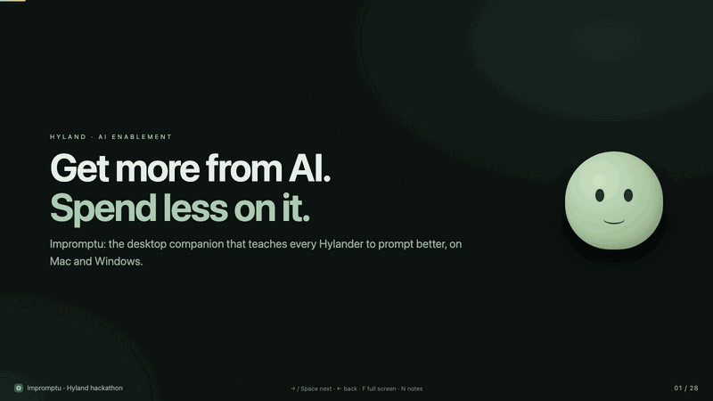
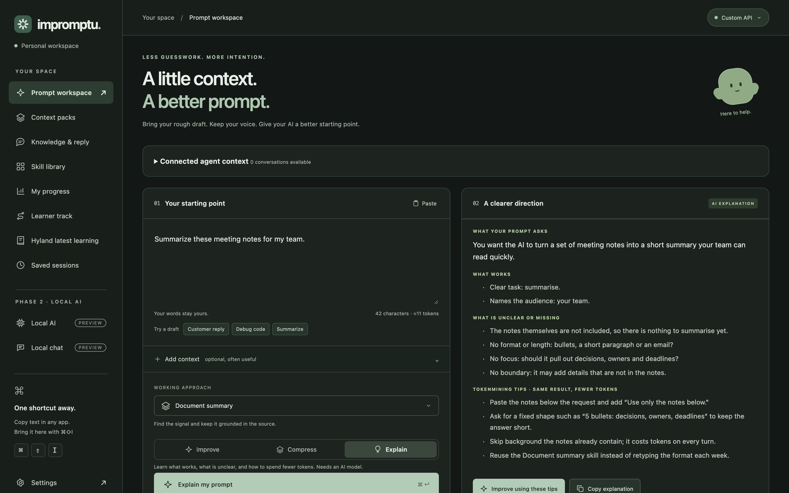
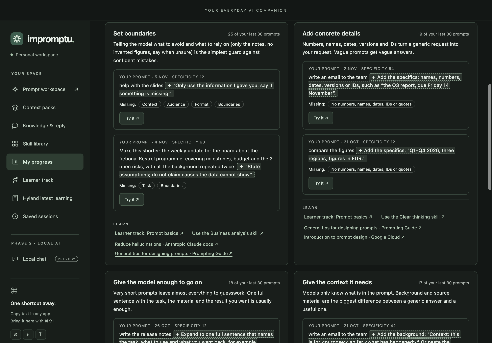
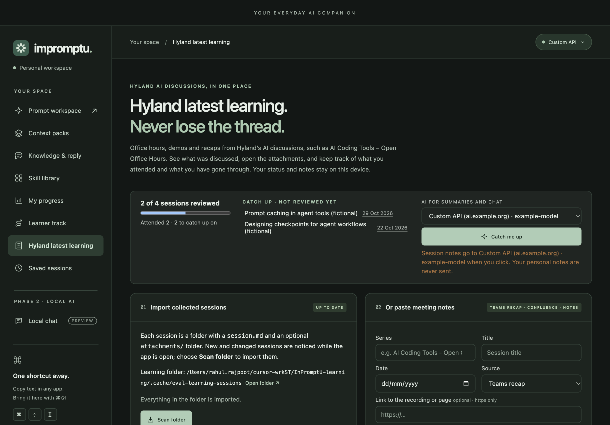
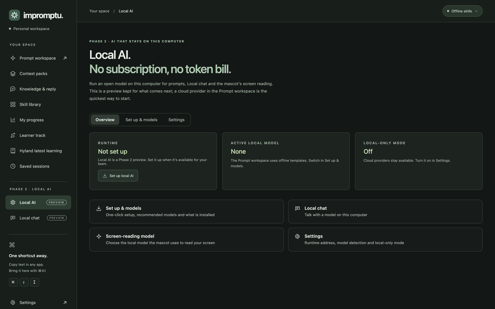

  

<h1 align="center">Impromptu</h1>

  <b>Get more from AI. Spend less on it.</b> 
  The desktop companion that teaches every Hylander to prompt better, on Mac and Windows.

  
  
  

  <a href="https://rajpoot-rahul.github.io/InPromptU/pitch/"><b>▶ Play the pitch deck</b></a>
  &nbsp;·&nbsp;
  <a href="https://github.com/rajpoot-rahul/InPromptU/releases/latest/download/Impromptu-Mac-Apple-Silicon-Installer.pkg"><b>Download for Mac</b></a>
  &nbsp;·&nbsp;
  <a href="https://github.com/rajpoot-rahul/InPromptU/releases/latest/download/Impromptu-Windows-x64-Setup.exe"><b>Download for Windows</b></a>
  &nbsp;·&nbsp;
  <a href="docs/guide.md"><b>User guide</b></a>

   
  Click the trailer to play all 28 slides in your browser: → or Space moves on, F goes full screen.

## Why Impromptu

AI is now a line item every team depends on, and that makes us exposed: prices can jump the moment investors decide to cash out, and a provider can go dark overnight.

There are about 5,000 Hylanders. By our own estimate, around half of us were never taught to prompt well, so the same tools give very different results, and the money goes on re-asking, re-explaining and pasting the same context again.

Impromptu fixes it at the root. It sits between you and whichever AI you use and teaches **tokenmining**: the same result from fewer tokens. The cheapest token is the one you never had to send.

## What it does

| Feature | What you get |
| --- | --- |
| **Prompt workspace** | Select text in any app and press <kbd>⌘</kbd> <kbd>⇧</kbd> <kbd>I</kbd> (<kbd>Ctrl</kbd> <kbd>Shift</kbd> <kbd>I</kbd> on Windows), then **Improve**, **Compress** or **Explain**. In one test, Compress took a prompt from ≈96 to ≈39 estimated tokens and kept every detail. |
| **Hyland knowledge** | Replies grounded in Confluence and Jira, using your own Atlassian permissions. Every fact has to quote a retrieved passage. |
| **Context packs** | Carry a long AI session to another model, take out what you don't need, and come back with one sharp prompt. |
| **Skillify** | A prompt that worked becomes a reusable team skill, shared as a file. |
| **My progress** | A private Prompt Specificity score, your weak spots shown with your own prompts, and reading for each one. |
| **Learner track** | From prompts to skills, agents and multi-agent workflows, with a benchmark and an opt-in leaderboard. |
| **Hyland latest learning** | Hyland's AI sessions in one place: attended, reviewed, and **Catch me up** for what you missed. |
| **On-screen mascot** | Opt-in help and nudges where you work: a break after a long session, repeated prompts, claims to fact-check. |

| Prompt workspace | Knowledge & reply |
| --- | --- |
|  |  |
| **My progress** | **Hyland latest learning** |
|  |  |

Screenshots use fictional sample data.

## Phase 2: local AI

**No subscription. No token bill.** Impromptu can run open models on the employee's own Mac or PC. Everyday prompting keeps working if prices jump or a provider goes dark, and prompts never leave the device. The Local AI tab is already in the app as a Phase 2 preview, with one-click setup and models matched to each computer. It stays off until it's approved.

  

## Trust by design

- Everything stays on the device by default, and the app itself enforces a local-only switch.
- Likely secrets are removed from imported context before it's saved.
- The mascot reads the screen only after explicit consent, and only when you click.
- No telemetry, no central database and no employee scoring.

## See it in three minutes

1. Copy a vague Teams message, press <kbd>⌘</kbd> <kbd>⇧</kbd> <kbd>I</kbd> and choose **Compress**.
2. **Explain** a messy prompt, then **Improve** it with Hyland evidence.
3. Bring a long AI session in as a **Context pack**, try it on another model and hand back one sharp prompt.
4. Open **My progress** to see your weak spots, then the **Learner track**.
5. Open **Hyland latest learning** and choose **Catch me up**.

## What's next

We're asking for a pilot with two or three teams, including a non-technical one; approval for the Phase 2 local AI runtime; and a real code-signing certificate. The pilot will measure tokens per accepted answer, time to a usable result and the Prompt Specificity trend, before and after. We'd rather prove the savings than claim them.

## Install

> [!NOTE]
> These are unsigned hackathon builds, so macOS Gatekeeper and Windows SmartScreen may warn before opening them.

- **Mac** (Apple Silicon, macOS 13 or later): [Impromptu-Mac-Apple-Silicon-Installer.pkg](https://github.com/rajpoot-rahul/InPromptU/releases/latest/download/Impromptu-Mac-Apple-Silicon-Installer.pkg), then open **Applications → Impromptu**.
- **Windows** (x64): [Impromptu-Windows-x64-Setup.exe](https://github.com/rajpoot-rahul/InPromptU/releases/latest/download/Impromptu-Windows-x64-Setup.exe), then open **Impromptu** from the Start menu.

Checksums and every asset are on the [latest release](https://github.com/rajpoot-rahul/InPromptU/releases/latest). The [v0.2.9 release notes](docs/releases/v0.2.9.md) cover what changed and the known limitations.

## Learn more

- [User guide](docs/guide.md): every workflow, the AI and knowledge connections, privacy and storage, and what has and hasn't been verified.
- [Concept and product vision](docs/concept.md) and the [demo walkthrough](docs/demo.md).
- [Pitch deck](https://rajpoot-rahul.github.io/InPromptU/pitch/): plays in the browser. The source is [`pitch/index.html`](pitch/index.html), which also runs offline from a clone or ZIP.
- [Contributing](CONTRIBUTING.md): Node 24 LTS, `npm ci`, `npm run dev`, `npm run verify` and the release flow.

Built for the <a href="https://impromptu-hackathon-brief.hyland-0170.chatgpt.site/#idea">Impromptu hackathon brief</a>.
